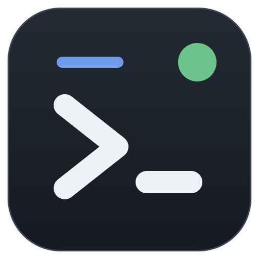
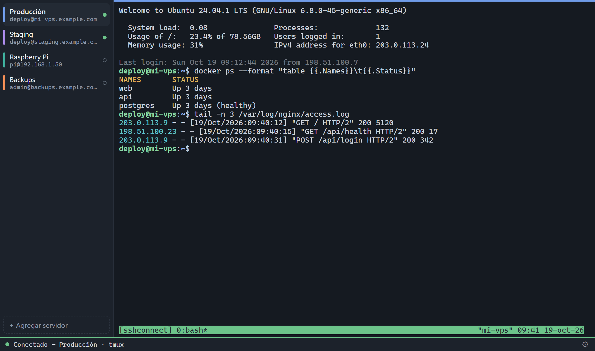
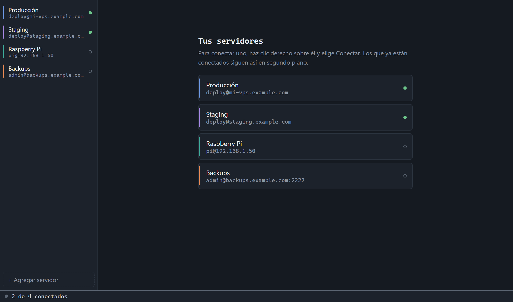
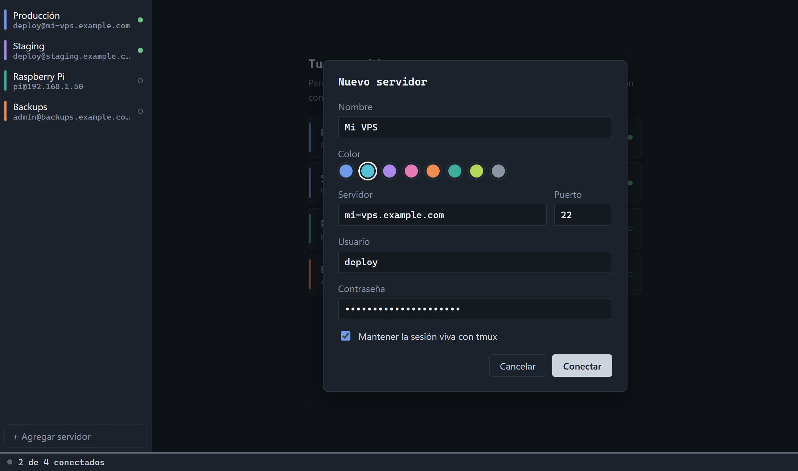
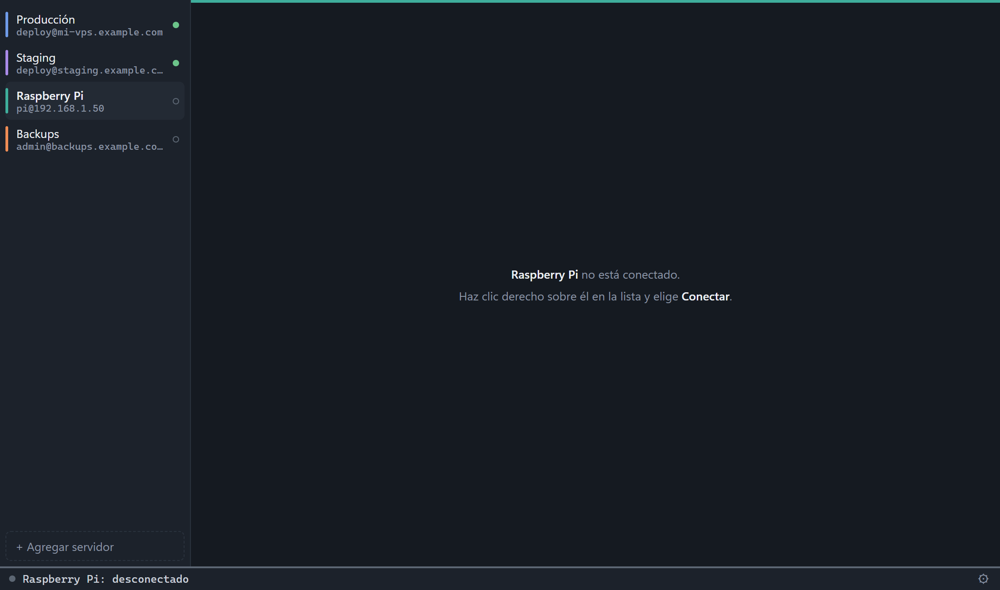

<p align="center">
  
</p>

<h1 align="center">SSH Connect</h1>

<p align="center">
  Cliente SSH minimalista para Windows, pensado para que <b>la sesión nunca se caiga</b>.
</p>



Guarda una lista de servidores, cada uno con un nombre y un color para reconocerlo. Puedes tener varios conectados a la vez, con una terminal por servidor. Si se va el internet o suspendes la PC, se reconecta solo y vuelve a la misma sesión de tmux, con todo lo que estaba corriendo.

## Capturas

| Tus servidores | Agregar un servidor |
|---|---|
|  |  |
| Cada servidor tiene su color. El punto verde indica los que están conectados. | La app prueba la conexión antes de guardar. |



Nada se conecta solo: un servidor se conecta con **clic derecho → Conectar**.

> Las capturas usan servidores y direcciones de ejemplo.

## Funciones

- **Keepalive SSH:** cada 15 s se manda una señal al servidor. Si no responde 3 veces seguidas, la conexión se da por perdida.
- **Reconexión automática e infinita:** espera 1, 2, 5, 10 y 30 s entre intentos. A partir de ahí reintenta cada 30 s para siempre.
- **tmux en el servidor:** si el servidor tiene tmux, la terminal abre la sesión `sshconnect` (`tmux -u new-session -A -s sshconnect`). Al reconectar vuelves a la misma sesión, con todo lo que estaba corriendo. `-u` fuerza UTF-8 para que los acentos y emojis se vean bien, y `window-size latest` evita que la ventana se encoja si otra PC se une a la misma sesión. Si no hay tmux, se abre un shell normal y la barra te avisa. Si el servidor no contesta a tiempo al revisar tmux, la app reconecta en vez de abrir un shell sin tmux.
- **Despertar la PC o volver la red:** al salir de la suspensión, o cuando Windows avisa que volvió la red, cada sesión que estaba esperando su siguiente intento de reconexión lo hace en ese momento (si ya hay un intento en curso, lo deja terminar). Las que parecían conectadas se comprueban, y si no responden en 8 s, se reconectan.
- **La PC no se suspende sola por inactividad** mientras haya un servidor conectado, conectándose, reconectando o con la sesión terminada, para que no se corte. Si cierras la tapa o eliges Suspender, sí se suspende. Cuando desconectas todos, vuelve a suspenderse sola con normalidad.
- **Huella del servidor (TOFU):** la primera conexión guarda la huella SHA256 del servidor, en el mismo formato que OpenSSH. Si después cambia, la app no conecta y te avisa, porque puede ser un ataque.
- **Contraseñas cifradas** con DPAPI de Windows (`safeStorage` de Electron).
- **Portapapeles por OSC 52:** los programas del servidor (vim, tmux, OpenCode…) pueden copiar directo a tu portapapeles de Windows. Esto funciona también a través de tmux. Cada copia se avisa unos segundos en la barra ("vps copió 120 caracteres al portapapeles"), y una copia de más de 1 MB se rechaza.
- **Enlaces:** se abren con **Shift+clic**. Solo se abren direcciones `http://` y `https://`.
- **Nada se conecta sin que lo pidas:** ni al abrir la app ni al elegir un servidor. Solo se conecta con **clic derecho → Conectar**.

## Instalación

1. Descarga `SSH-Connect-Setup-<versión>.exe` desde la [última versión](https://github.com/davidhielo91/ssh-connect/releases/latest) (en *Assets*).
2. Ejecútalo. Como el instalador no está firmado, Windows SmartScreen avisará la primera vez: "Más información" → "Ejecutar de todas formas".

Tus servidores se guardan aparte del programa, así que actualizar o reinstalar no los borra.

## Uso

### Servidores

- **Clic normal en un servidor:** solo lo muestra. Si no está conectado, ves el aviso "no está conectado".
- **Clic derecho en un servidor:** abre un menú con **Conectar** (o **Desconectar** si ya está conectado), **Editar…** y **Eliminar…**. Es la única forma de conectar un servidor guardado. Una vez conectado, si se cae la red, se reconecta solo hasta que lo desconectes.
- **Agregar:** usa "+ Agregar servidor" y escribe el nombre, el color, la dirección, el puerto, el usuario y la contraseña. La app **prueba la conexión antes de guardar**. Si funciona, el servidor nuevo queda conectado. Si falla, no se guarda y el formulario te muestra el error.
- **Editar:** usa el lápiz ✎ junto al servidor o el engrane ⚙ de la barra de estado. Si cambias solo el nombre o el color, se guarda sin reconectar. Si cambias datos de conexión, se vuelven a probar. Si el servidor estaba desconectado, después de la prueba vuelve a quedar desconectado. Si dejas la contraseña vacía, se conserva la guardada.
- **Eliminar:** con clic derecho → Eliminar… (pide confirmación), o en el formulario con "Eliminar" y después "Sí, eliminar" (tienes 4 s para confirmar).
- **Desconectar:** con clic derecho → Desconectar, o desde el formulario de edición. Deja de reintentar hasta que lo vuelvas a conectar.
- Si la contraseña es incorrecta o la huella cambió, la app no reintenta y abre el formulario (si estás viendo ese servidor; si no, el aviso aparece al editarlo). En el caso de la huella, presiona **Guardar** para aceptar la nueva, pero hazlo solo si sabes por qué cambió (por ejemplo, porque reinstalaste el servidor).
- Si la contraseña guardada no se puede leer, por ejemplo después de cambiar de usuario de Windows, la app te la pide de nuevo.

### Estados (el punto junto a cada servidor y la barra de abajo)

| Punto | Estado | Significado |
|---|---|---|
| verde | conectado | Sesión activa (la barra muestra "· tmux" si se está usando tmux) |
| ámbar | conectando / reconectando | Intentando conectar; la línea de la barra se llena hasta el siguiente intento |
| gris relleno | sesión terminada | El shell se cerró (`exit` o salir de tmux) pero la conexión sigue viva: presiona **Enter** para abrir otro |
| rojo | con error | Falló y no se reintenta (contraseña, huella) |
| gris vacío | desconectado | No está abierto |

## Atajos

| Atajo | Acción |
|---|---|
| Ctrl+C | Copia si hay texto seleccionado; si no, manda ^C al servidor |
| Ctrl+Shift+C | Copia la selección (nunca manda ^C) |
| Ctrl+V / Ctrl+Shift+V | Pega |
| Clic derecho en la terminal | Copia la selección; si no hay, pega (como PuTTY) |
| Clic derecho en un servidor de la lista | Menú: Conectar / Desconectar, Editar…, Eliminar… |
| Shift+arrastrar | Selecciona texto aunque el programa use el mouse |
| Shift+clic | Abre el enlace |
| Ctrl+1 … Ctrl+9 | Va al servidor 1…9 de la lista |
| Ctrl+Tab / Ctrl+Shift+Tab | Siguiente / anterior servidor abierto |
| Ctrl+F | Busca en la terminal (Enter siguiente, Shift+Enter anterior, Esc cierra) |
| Ctrl+rueda, Ctrl++ / Ctrl+- / Ctrl+0 | Tamaño de la fuente (se recuerda); Ctrl+0 lo restablece |
| Enter | Tras "sesión terminada", abre un shell nuevo |
| Esc | Cierra el formulario |

Sobre el clic derecho, hay dos casos especiales:
- Si el programa del servidor ya copió algo por OSC 52 desde tu última tecla, el clic derecho no pega. Así, seleccionar con el programa y luego dar clic derecho funciona como "copiar".
- Si el programa usa el mouse (por ejemplo OpenCode, que copia con clic derecho), la app espera 600 ms antes de pegar. Si en ese tiempo el programa copió algo, no pega.

**Historial dentro de tmux:** tmux usa su propia pantalla, así que la rueda del mouse no recorre el historial de la terminal. Para ver lo anterior usa `Ctrl+B` y luego `[`, muévete con las flechas o RePág/AvPág, y sal con `q`.

**Avisos:** si un programa del servidor manda la campana (`\a`) y no estás mirando ese servidor, aparece un punto ámbar junto a él y, si la ventana no está en primer plano, una notificación de Windows (al hacer clic se abre ese servidor). Para que te avise al terminar un comando largo: `comando; printf '\a'`. La barra de estado muestra la latencia al servidor (en ámbar si pasa de 400 ms); se mide cada 15 s con un canal corto.

## Dónde se guardan los datos

`%APPDATA%\SSH Connect\servers.json` contiene:

```json
{
  "servers": [{ "id": "…", "name": "…", "color": "blue", "host": "…", "port": 22,
                "username": "…", "useTmux": true, "hostFingerprint": "SHA256:…",
                "passwordEnc": "…" }]
}
```

- `passwordEnc` está cifrada con DPAPI, que la ata a **tu usuario de Windows en esta PC**. Si copias el archivo a otra PC o a otro usuario, la contraseña no se puede leer y la app la pide de nuevo.
- Las versiones anteriores guardaban un solo servidor en `config.json`. Si existe, se migra una vez a un servidor llamado "Mi servidor" y el archivo se renombra a `config.json.bak`.

## Desarrollo

Requisitos: Node.js y npm 11.

```sh
npm install      # instala dependencias (solo electron ejecuta su script de instalación)
npm start        # abre la app en modo desarrollo
npm run dist     # genera dist/SSH-Connect-Setup-<versión>.exe (instalador NSIS, con el ícono de build/icon.png)
node --check main.js   # revisión rápida de sintaxis
```

- npm 11 bloquea los scripts de instalación por defecto. Solo `electron` está permitido (`allowScripts` en `package.json`), porque necesita descargar su binario. La criptografía nativa opcional de `ssh2` no se compila a propósito, así que usa la versión en JavaScript. Por eso también `npmRebuild: false` en la configuración de electron-builder.
- No hay pruebas automáticas, linter ni bundler.

**Publicar una versión:** sube `version` en `package.json`, ejecuta `npm run dist` y crea un Release en GitHub (tag `v<versión>`) con tres archivos de `dist/`: `SSH-Connect-Setup-<versión>.exe`, su `.blockmap` y `latest.yml`. La app instalada revisa los Releases al abrir y cada 6 horas, descarga la versión nueva en segundo plano y muestra un botón **Actualizar a vX.Y.Z** en la barra de abajo; si no lo usas, se instala al cerrar la app. Reiniciar corta las sesiones abiertas (con tmux retomas lo que corría), y por eso pregunta antes. La actualización solo funciona desde la versión 1.1.0 en adelante.

### Pruebas manuales

1. Levanta un servidor SSH desechable con `ssh2` (`Server`, con autenticación por contraseña y respuestas falsas para `command -v tmux` / `tmux new-session`), **fuera del repositorio**.
2. Abre la app con un perfil temporal para no tocar tu configuración real:
   `npx electron . --remote-debugging-port=9229 --user-data-dir=<carpeta temporal>`
3. Controla la app por CDP (`WebSocket` de Node + `Runtime.evaluate`). Desde ahí están accesibles `servers`, `active`, `views`, `select`, `openForm`, `field`, `api`, `$` y `doFit`.
4. Cierra con `window.close()`, no matando el proceso. La llave de DPAPI se guarda al salir limpiamente, y si matas el proceso las contraseñas pueden quedar ilegibles.

Si la ventana está tapada, el `ResizeObserver` no se dispara y hay que llamar `doFit()` a mano. El bloqueo de instancia única es por `--user-data-dir`.

## Arquitectura

```
┌──────────────┐   IPC    ┌───────────────┐  window.api  ┌──────────────────────┐
│   main.js    │ ◀──────▶ │  preload.js   │ ◀──────────▶ │ renderer/ (xterm.js) │
│ ssh2, tmux,  │          │ contextBridge │              │ lista, terminales,   │
│ guardado,    │          └───────────────┘              │ barra, formulario    │
│ portapapeles │                                         └──────────────────────┘
└──────────────┘
```

- **`main.js`** contiene toda la lógica SSH y de la app. Hay una instancia de `Session` por servidor abierto, cada una con su `Client` de ssh2. Cada intento de conexión tiene un número (`gen`), y los eventos de intentos viejos se ignoran.
- **`preload.js`** expone `window.api`. La ventana usa `sandbox: true` y `contextIsolation: true`.
- **`renderer/`** usa HTML, CSS y JS sin framework. Carga xterm y sus addons (fit y web-links) directo desde `node_modules`. Hay una terminal por servidor abierto, y solo se ve la del servidor activo.

### Canales IPC

| Canal | Dirección | Uso |
|---|---|---|
| `servers:list` | renderer → main | Lista de servidores (sin contraseñas) |
| `server:save` | renderer → main | Prueba y guarda el formulario; responde `{ok, error, kind, id}` |
| `server:delete` | renderer → main | Elimina un servidor |
| `session:open` / `session:close` | renderer → main | Abre (con reintentos) o cierra la sesión de un servidor |
| `server:menu` | renderer → main | Muestra el menú del clic derecho de un servidor |
| `server:action` | main → renderer | Lo elegido en ese menú: `connect`, `disconnect`, `edit` o `delete` |
| `session:wake` | renderer → main | La red volvió: reintentar o comprobar sesiones |
| `ssh:write` / `ssh:resize` | renderer → main | Teclado y tamaño de la terminal |
| `clip:write` / `clip:read` | renderer → main | Portapapeles |
| `link:open` | renderer → main | Abre un enlace http(s) en el navegador |
| `ssh:data` | main → renderer | Salida del servidor `(id, datos)` |
| `ssh:status` | main → renderer | Cambio de estado `{id, state, …}` |

### Estados de una sesión

```
idle ─▶ connecting ─▶ connected ─(exit del shell)─▶ ended ─(Enter)─▶ connected
            │             │
            │             └─(caída)─▶ reconnecting ─(espera o despertar)─▶ nuevo intento
            │
            └─(contraseña o huella)─▶ failed ◀─(contraseña o huella)─ reconnecting
```

- **`failed`** lleva `kind`: `auth` (contraseña), `fingerprint` (huella cambió) o `test` (falló la prueba del formulario). Ninguno se reintenta.
- **`idle`** es el estado tras desconectar a mano.
- En el *modo prueba* (al guardar el formulario) no hay reintentos. En el *modo guardado* (abrir un servidor) se reintenta para siempre.

## Seguridad

- La huella de cada servidor se guarda la primera vez; si cambia, la app no conecta y te avisa.
- Las contraseñas se guardan cifradas con DPAPI y solo se pueden leer con tu usuario de Windows en esta PC.
- La ventana no carga nada de internet: no navega a otras páginas, no abre ventanas y no pide permisos (cámara, micrófono, notificaciones).
- Solo se abren enlaces `http` y `https`, y siempre con Shift+clic.
- Un servidor solo puede copiar a tu portapapeles hasta 1 MB, y cada copia se avisa en la barra.
- El instalador desactiva los modos de depuración (`ELECTRON_RUN_AS_NODE`, `NODE_OPTIONS`, `--inspect` y `--remote-debugging-port`) y verifica la integridad de su código al abrir. Así otro programa no puede abrir SSH Connect de forma especial para controlarlo.
- Lo que pegas se limpia del carácter ESC, para que un texto copiado de una página no pueda ejecutar comandos escondidos.

## Limitaciones (por diseño)

Para que la app siga siendo simple:

- Solo autenticación por **contraseña** (sin llaves SSH).
- Sin SFTP ni transferencia de archivos.
- Sin snippets ni comandos guardados.
- Solo Windows.
- El instalador **no está firmado**, así que Windows SmartScreen mostrará un aviso la primera vez ("Más información" → "Ejecutar de todas formas").

## Licencia

[MIT](LICENSE) © davidhielo91
